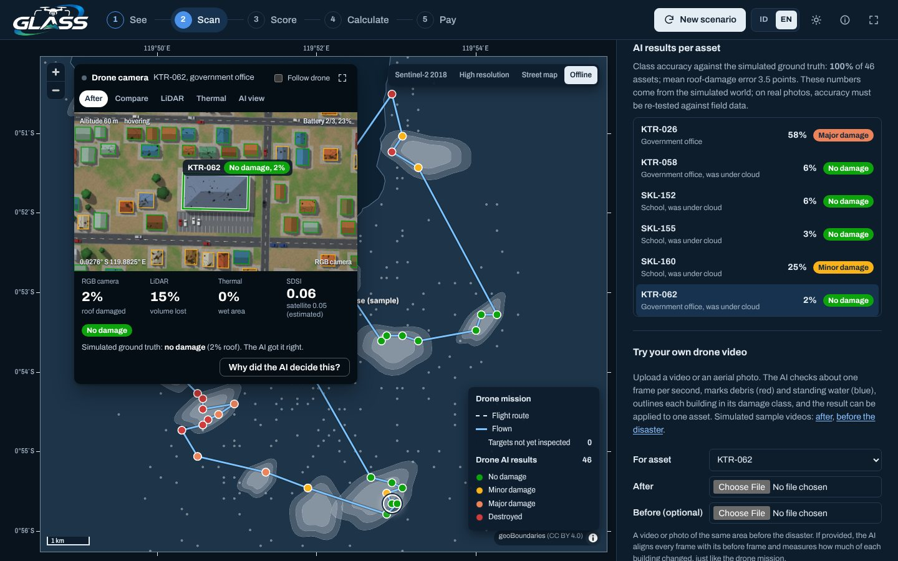

# GLASS Dashboard

[English](README.md)

Dasbor prototipe **GLASS** (Geo-Actuarial Autonomous Loss Assessment System). Dasbor ini mengubah bukti kerusakan
bencana dari satelit dan drone menjadi angka klaim asuransi aset negara, secara otomatis. Studi kasusnya gempa dan
tsunami Palu, 28 September 2018, dengan data contoh.

Coba langsung: **[glass.dharmacipta.com](https://glass.dharmacipta.com)**



## Yang bisa dilakukan

| Langkah | Di peta | Di panel |
|---|---|---|
| 1. Lihat | Peta panas foto satelit, radar, dan banjir; awan; sesar; likuefaksi | Pilihan sensor, slider tutupan awan |
| 2. Pindai | Rute drone, drone terbang, target diwarnai kelas kerusakan hasil AI | Kamera drone (RGB, LiDAR, termal, mata AI), hasil misi, unggah video |
| 3. Nilai | Aset diwarnai zona SDSI | Rumus SDSI, komposisi zona, kalkulator |
| 4. Hitung | Lingkaran sebesar estimasi klaim, garis ke 5 tetangga | Cadangan klaim, IBNR, kurva PML, AAL |
| 5. Bayar | Medan guncangan dan garis ambang, aset yang dapat uang muka | Slider ambang & uang muka, basis risk, sertifikat kerugian digital |

Fitur utama:

- **Drone AI.** Drone simulasi membawa tiga sensor sesuai rancangan GLASS (kamera RGB, LiDAR, termal LWIR). Tiap
  bangunan dibandingkan dengan digital twin sebelum bencana, lalu AI memberi persentase atap rusak, volume hilang, dan
  area basah, serta kelas kerusakan. Panel *Kenapa AI menilai begini?* menunjukkan buktinya.
- **Video drone sendiri.** Unggah video atau foto. Kalau video sebelum bencana ikut diunggah, tiap gambar disejajarkan
  dengan gambar sebelumnya (fitur ORB, RANSAC, cek tepi) dan kerusakan dihitung dari perubahan, sama seperti misi.
  Tanpa video sebelum, aturan visi komputer satu gambar memperkirakan puing dan genangan.
- **VLM opsional.** Ollama, server yang kompatibel dengan OpenAI, atau Anthropic bisa menjelaskan gambar dengan
  kalimat. Fitur lain tetap jalan tanpa VLM.
- **Inti aktuaria.** Skor SDSI, klaim, cadangan klaim, IBNR spasial, PML dan AAL dari simulasi 100.000 tahun,
  pembayaran hibrida parametrik-indemnitas dengan basis risk, dan sertifikat SHA-256.
- **Siap presentasi.** Bahasa Indonesia dan Inggris (`L`), tema terang dan gelap (`T`), pintasan papan ketik, dan peta
  offline otomatis kalau citra satelit gagal dimuat.

## Yang asli dan yang disimulasikan

| Asli | Perkiraan | Simulasi |
|---|---|---|
| Garis pantai Teluk Palu (geoBoundaries), citra Sentinel-2 2018, episentrum M7,5 (USGS) | Jejak sesar Palu-Koro, pusat likuefaksi | Aset dan nilainya, kerusakan, awan, guncangan per aset, asumsi frekuensi PML, semua citra drone |

Dasbor ini membuktikan alur GLASS berjalan dari awal sampai akhir. Angka rupiahnya **bukan** perkiraan kerugian Palu
yang sebenarnya, dan ketepatan drone AI diukur di dunia simulasi, tempat kondisi sebenarnya diketahui.

## Menjalankan

Perlu Docker dengan Compose. Image bisa dibangun di amd64 dan arm64 (Apple Silicon).

```bash
cp .env.example .env          # ganti GLASS_PORT kalau 3070 sudah dipakai
docker compose up -d --build
docker compose ps             # tunggu api dan web "healthy"
```

Buka `http://localhost:3070`. Alamat berguna:

| Alamat | Fungsi |
|---|---|
| `/#pindai`, `/#bayar`, … | Langsung membuka langkah tertentu |
| `/?lang=en`, `/?theme=dark` | Memaksa bahasa atau tema untuk tautan yang dibagikan |
| `/api/docs` | Dokumentasi API interaktif |

Semua pengaturan ada di `.env` (lihat [.env.example](.env.example) dan tabel lengkap di [README.md](README.md#configuration)).
Untuk menyalakan VLM di Mac: `brew install ollama && ollama pull qwen3-vl:2b`, isi `GLASS_VLM_PROVIDER=ollama`, lalu
`docker compose up -d --force-recreate api`.

## Pintasan papan ketik

| Tombol | Fungsi |
|---|---|
| `1`–`5`, `←` `→` | Pindah langkah |
| `Spasi` | Terbangkan, jeda, atau lanjutkan drone (langkah Pindai) |
| `S` | Skenario baru (sapuan satelit diulang) |
| `L` | Ganti bahasa Indonesia / Inggris |
| `T` | Ganti tema terang / gelap |
| `F` | Layar penuh |
| `Esc` | Tutup detail aset atau kamera besar |

## Memakai data aset asli

Taruh file GeoJSON titik di `./data/`, isi `GLASS_ASSETS_FILE=/data/<file>.geojson`, lalu nyalakan ulang API. Contoh
format lengkap: [data/contoh_format_aset.geojson](data/contoh_format_aset.geojson). Properti yang dibutuhkan: `id`,
`type` (`sekolah`, `puskesmas`, `kantor`, `jembatan`), `sum_insured`, `d_vol`, `d_surf`, `d_water`, `mmi`, dan
`observed` (opsional).

## Pengembangan

```bash
# API (Python 3.12)
cd api
pip install -r requirements-dev.txt
uvicorn app.main:app --reload --port 8000
pytest -q

# Web (Node 22), di terminal lain
cd web
npm install
API_URL=http://127.0.0.1:8000 npm run dev    # http://localhost:3000
npm run typecheck
```

Teks antarmuka ada di `web/src/lib/i18n/id.tsx` dan `en.tsx`. Kunci di versi Inggris wajib sama dengan versi
Indonesia, dicek oleh TypeScript.

## Dokumentasi teknis (bahasa Inggris)

- [Arsitektur](docs/architecture.md): layanan, alur data, cache, bahasa, tema
- [Model](docs/model.md): SDSI, zona, klaim, cadangan, IBNR, PML, pembayaran, dan semua asumsinya
- [Drone AI](docs/drone-ai.md): simulator, rencana misi, analisis kerusakan, unggah video, VLM, batasan
- [Referensi API](docs/api.md): semua endpoint beserta bentuk request dan response

Dibuat oleh Tim GLASS, SMA Negeri Bali Mandara.
