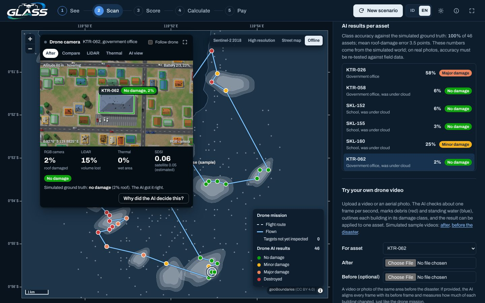
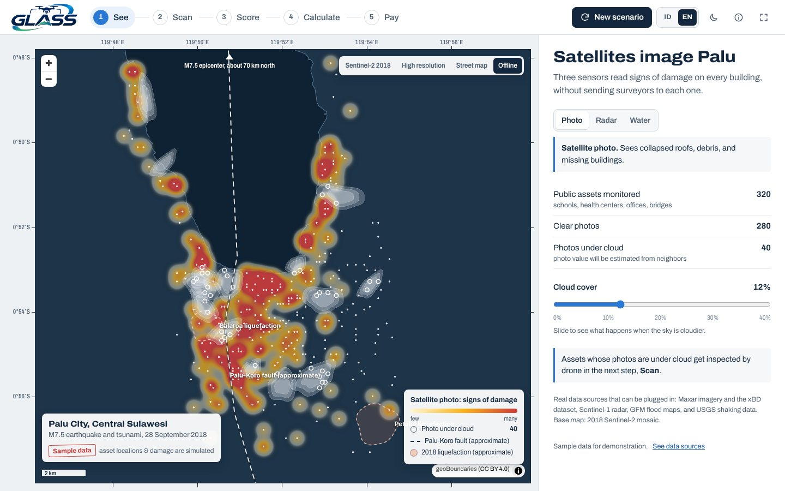
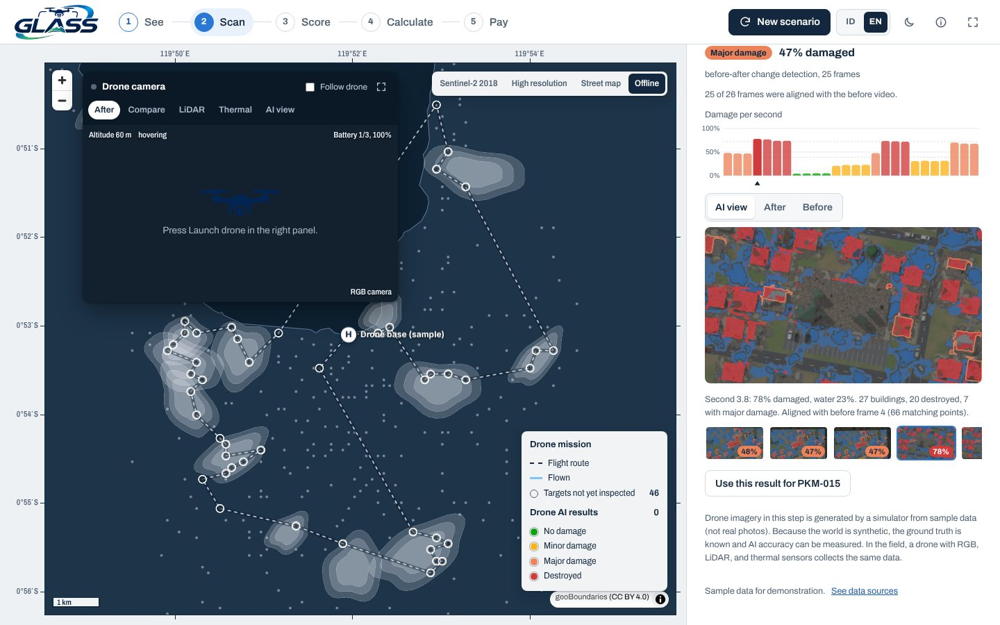
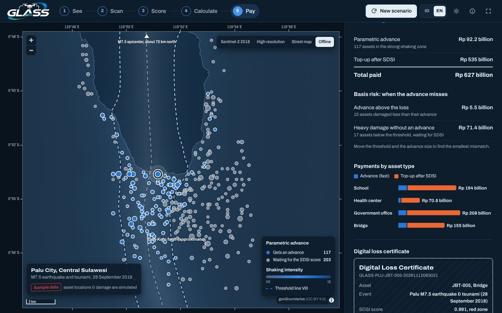

# GLASS Dashboard

[Bahasa Indonesia](README.id.md)

Prototype dashboard for **GLASS** (Geo-Actuarial Autonomous Loss Assessment System). It turns satellite and drone
evidence of disaster damage into insurance claim amounts for public assets, automatically. The case study is the
Palu earthquake and tsunami of 28 September 2018, run on sample data.

Live demo: **[glass.dharmacipta.com](https://glass.dharmacipta.com)**



| See: satellite sensors | Scan: before/after video upload | Pay: advance, top-up, certificate |
|---|---|---|
|  |  |  |

## What it does

The dashboard walks through the five GLASS steps on one map.

| Step | On the map | In the panel |
|---|---|---|
| 1. See | Heatmaps from satellite photo, radar, and flood data; clouds; fault line; liquefaction areas | Sensor switch, cloud-cover slider |
| 2. Scan | Planned drone route, live drone, targets colored by AI damage class | Drone camera (RGB, LiDAR, thermal, AI view), mission results, video upload |
| 3. Score | Assets colored by SDSI zone | SDSI formula, zone breakdown, calculator |
| 4. Calculate | Circles sized by estimated claim, links to the 5 nearest neighbors | Case reserves, IBNR, PML curve, AAL |
| 5. Pay | Shaking field and trigger line, assets that get an advance | Trigger and advance sliders, basis risk, digital loss certificate |

Highlights:

- **Drone AI.** A simulated drone carries the three sensors from the GLASS design (RGB camera, LiDAR, LWIR thermal).
  For every building it compares the scene with the pre-disaster digital twin and reports roof damage, volume loss,
  and wet area as percentages, then a damage class. The *Why did the AI decide this?* panel shows the evidence.
- **Your own drone footage.** Upload a video or photo. If you also upload footage from before the disaster, every
  frame is aligned to its before frame (ORB features, RANSAC, edge check) and damage is measured as change, the
  same way the mission does. Otherwise a single-frame rule set estimates debris and standing water.
- **Optional vision-language model.** Ollama, any OpenAI-compatible server, or Anthropic can describe frames in a
  sentence. Everything else works without it.
- **Actuarial core.** SDSI scores, claims, case reserves, spatial IBNR, PML and AAL from a 100,000-year Monte Carlo
  run, a hybrid parametric/indemnity payout with basis risk, and a SHA-256 loss certificate.
- **Ready to present.** Indonesian and English (`L`), light and dark themes (`T`), keyboard shortcuts, and an offline
  basemap that takes over when satellite tiles fail to load.

## What is real and what is simulated

| Real | Approximate | Simulated |
|---|---|---|
| Palu Bay coastline (geoBoundaries), 2018 Sentinel-2 imagery, the M7.5 epicenter (USGS) | Palu-Koro fault trace, liquefaction centers | Assets and their values, damage, clouds, shaking per asset, PML frequency assumptions, all drone imagery |

The dashboard proves the pipeline runs end to end. Its rupiah figures are **not** an estimate of the actual Palu
losses, and the drone AI's accuracy is measured inside the simulated world, where the ground truth is known. Testing
on real imagery (for example RescueNet or FloodNet) is listed in [docs/drone-ai.md](docs/drone-ai.md#limitations).

## Quick start

Requirements: Docker with Compose. Images build on amd64 and arm64 (Apple Silicon).

```bash
cp .env.example .env          # set GLASS_PORT if 3070 is taken
docker compose up -d --build
docker compose ps             # wait until api and web are healthy
```

Open `http://localhost:3070`. Only the `web` container publishes a port; it forwards `/api/*` to the `api`
container inside the Compose network.

Useful URLs:

| URL | What |
|---|---|
| `/#pindai`, `/#bayar`, … | Open a step directly (`lihat`, `pindai`, `nilai`, `hitung`, `bayar`) |
| `/?lang=en`, `/?theme=dark` | Force a language or theme for a shared link |
| `/api/docs` | Interactive API documentation |
| `/healthz`, `/api/health` | Health checks for the web and API containers |

## Configuration

All settings live in `.env` (see [.env.example](.env.example)).

| Variable | Default | Purpose |
|---|---|---|
| `GLASS_PORT` | `3070` | Host port for the dashboard |
| `GLASS_BIND` | `0.0.0.0` | Use `127.0.0.1` to expose it only through a local tunnel or proxy |
| `GLASS_ASSETS_FILE` | empty | Path inside the container (for example `/data/aset_palu.geojson`) to use real asset data instead of the sample |
| `GLASS_VLM_PROVIDER` | empty | `ollama`, `openai`, or `anthropic`; empty turns the VLM off |
| `GLASS_VLM_URL` | per provider | Ollama defaults to `http://host.docker.internal:11434` |
| `GLASS_VLM_MODEL` | per provider | Ollama `qwen3-vl:2b`, Anthropic `claude-haiku-5-5`; required for `openai` |
| `GLASS_VLM_API_KEY` | empty | For `openai` and `anthropic` |
| `GLASS_VLM_TIMEOUT` | `90` | Seconds per VLM request |
| `GLASS_MAX_UPLOAD_MB` | `300` | Size limit per uploaded file |
| `GLASS_CACHE_DIR` | `/tmp/glass-cache` | Rendered drone scenes, shared by all API workers |
| `GLASS_JOBS_DIR` | `/tmp/glass-jobs` | Upload jobs and their frames |
| `GLASS_CORS_ORIGINS` | empty | Comma-separated origins, only needed when the API is called from another site |

To run the VLM locally on a Mac: `brew install ollama && ollama pull qwen3-vl:2b`, then set
`GLASS_VLM_PROVIDER=ollama` and restart the API with `docker compose up -d --force-recreate api`.

## Keyboard shortcuts

| Key | Action |
|---|---|
| `1`–`5`, `←` `→` | Change step |
| `Space` | Launch, pause, or resume the drone (Scan step) |
| `S` | New scenario (replays the satellite sweep) |
| `L` | Switch between Indonesian and English |
| `T` | Switch between light and dark theme |
| `F` | Full screen |
| `Esc` | Close asset details or the enlarged camera |

## Using real asset data

Put a GeoJSON file of points in `./data/` and set `GLASS_ASSETS_FILE=/data/<file>.geojson`, then restart the API.
A full example is in [data/contoh_format_aset.geojson](data/contoh_format_aset.geojson).

| Property | Meaning |
|---|---|
| `id` | Asset code, for example `SKL-001` |
| `type` | `sekolah` (school), `puskesmas` (health center), `kantor` (government office), or `jembatan` (bridge) |
| `sum_insured` | Sum insured in rupiah |
| `d_vol` | 0–1, structural change from Sentinel-1 radar |
| `d_surf` | 0–1, damage class from imagery (xBD style: 0, 1/3, 2/3, 1) |
| `d_water` | 0–1, flooding or wetness |
| `mmi` | Shaking intensity at the site (USGS ShakeMap) |
| `observed` | `false` if the photo is hidden by cloud (optional) |

## Development

```bash
# API (Python 3.12)
cd api
pip install -r requirements-dev.txt
uvicorn app.main:app --reload --port 8000
pytest -q

# Web (Node 22), in a second terminal
cd web
npm install
API_URL=http://127.0.0.1:8000 npm run dev    # http://localhost:3000
npm run typecheck
```

Regenerate the sample drone videos (needs `ffmpeg` with libx264):

```bash
cd api && python tools/make_sample_video.py ../web/public/sample
```

## Project layout

```
api/
  glass/              GLASS engine (Python, numpy)
    params.py         SDSI weights, zones, policy and PML parameters
    scenario.py       sample Palu scenario: assets, clouds, shaking field
    sdsi.py           SDSI = w1·D_vol + w2·D_surf + w3·D_water
    actuarial.py      claims, PML and AAL (Monte Carlo)
    pipeline.py       See -> Scan -> Score -> Calculate -> Pay, spatial IBNR
    certificate.py    loss certificate with a SHA-256 fingerprint
    drone/            simulator, mission planner, vision AI, alignment, uploads, VLM client
  app/                FastAPI app, routers, request schemas
  tests/              pytest suite
  tools/              geometry builder and sample video generator
web/
  src/app/            Next.js App Router, /api proxy, health check
  src/components/     map (MapLibre), step panels, drone camera, charts
  src/lib/            API client, i18n dictionaries (id, en), formatting, theme
  public/             logos, offline coastline, sample videos
docs/                 architecture, model, drone AI, API reference
```

## Documentation

- [Architecture](docs/architecture.md): services, data flow, caching, i18n, and theming
- [Model](docs/model.md): SDSI, zones, claims, reserves, IBNR, PML, payouts, and every default assumption
- [Drone AI](docs/drone-ai.md): simulator, mission planning, damage analysis, video uploads, VLM, limitations
- [API reference](docs/api.md): every endpoint with request and response shapes

## Data sources and credits

- Imagery: Sentinel-2 cloudless 2018 by EOX IT Services (s2maps.eu, free for non-commercial use with attribution),
  Esri World Imagery, CARTO and OpenStreetMap.
- Coastline and boundaries: geoBoundaries gbOpen IDN ADM2 (CC BY 4.0).
- Epicenter: USGS event `us1000h3p4`. The fault trace and liquefaction centers are approximations used only to shape
  the sample damage pattern.
- Damage assessment approach: xBD (Gupta et al., 2019). Candidate datasets for testing on real drone imagery:
  RescueNet (Rahnemoonfar et al., 2023) and FloodNet (Rahnemoonfar et al., 2021).

Built by the GLASS team, SMA Negeri Bali Mandara.
