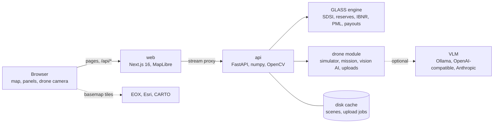
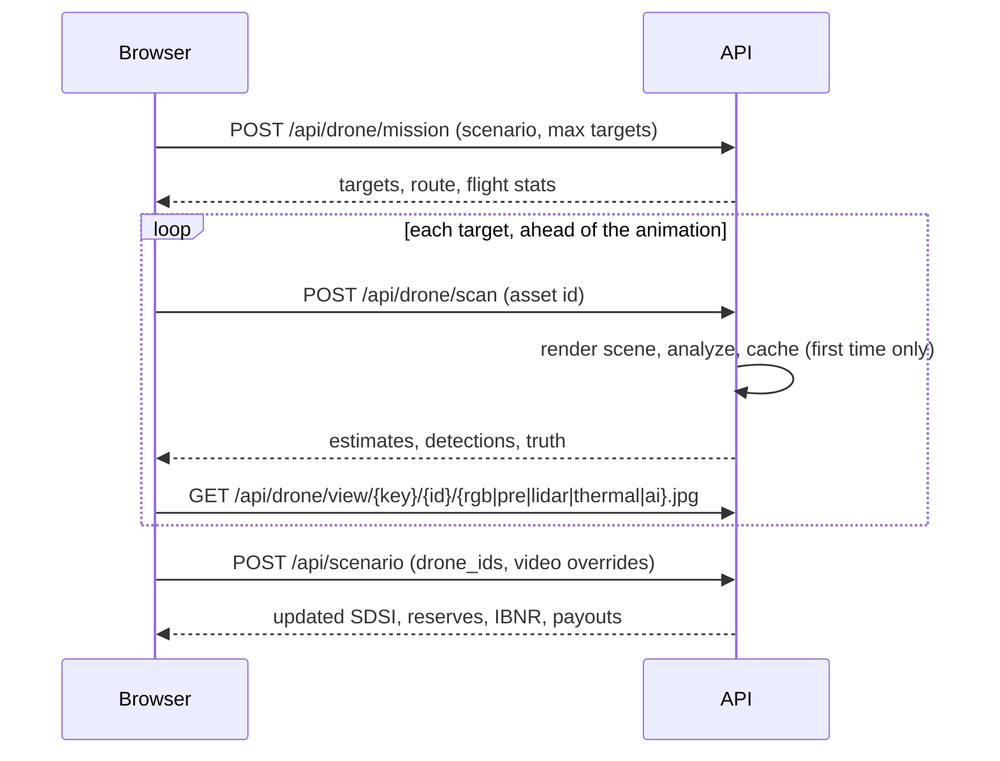

# Architecture

Two containers behind one port: a Next.js web app and a FastAPI engine. The browser only ever talks to the web app,
which forwards `/api/*` to the engine.

## Web (`web/`)

- **Next.js App Router**, built as a standalone server. The page is a single client component,
  [`Dashboard.tsx`](../web/src/components/Dashboard.tsx), that owns the scenario, policy, step, and drone state.
- **Proxy**: [`app/api/[...path]/route.ts`](../web/src/app/api/%5B...path%5D/route.ts) streams requests and responses
  to `API_URL` (default `http://api:8000`), including video uploads.
- **Map**: MapLibre GL with one set of layers for all steps. Each step is a *lens* that sets layer opacities and
  filters ([`layers.ts`](../web/src/components/map/layers.ts)). Basemaps: Sentinel-2 2018, Esri imagery, CARTO, and an
  offline coastline that takes over automatically when tiles fail to load.
- **Drone playback**: [`lib/mission.ts`](../web/src/lib/mission.ts) animates the drone with `requestAnimationFrame` and
  updates the map marker directly, so React only re-renders when a scan finishes. Scan results are fetched ahead of
  the animation, so the camera rarely has to wait for the server.
- **Charts** are hand-written SVG; colors come from CSS variables so they follow the theme.

### Languages

All interface text lives in two dictionaries, [`lib/i18n/id.tsx`](../web/src/lib/i18n/id.tsx) and
[`lib/i18n/en.tsx`](../web/src/lib/i18n/en.tsx). The English one is typed against the Indonesian one, so a missing key
fails the type check. Numbers, rupiah amounts, coordinates, and durations are formatted per language by
[`lib/format.ts`](../web/src/lib/format.ts) (`Rp 2,2 miliar` and `Rp 2.2 billion`).

The API returns codes rather than display text (damage class numbers, `method: "change"`, `error_code`), and the web
app turns them into words. Free text that only the server can produce (VLM summaries, certificates) is generated in
the requested language with `lang=en`.

Indonesian is the default. The choice is read from `?lang=`, then from local storage, and switched with the `ID | EN`
control or the `L` key.

### Themes

Colors are CSS variables on `:root`; `:root[data-theme="dark"]` redefines them. A small script in `<head>` sets the
theme before the first paint (from `?theme=`, then local storage, then the system setting), so there is no flash. The
drone camera stays dark in both themes, and the CARTO street map switches to its dark style.

## API (`api/`)

- **Routers**: [`app/routers/glass.py`](../api/app/routers/glass.py) for the scenario, calculator, and certificates;
  [`app/routers/drone.py`](../api/app/routers/drone.py) for missions, scans, images, VLM questions, and uploads.
- **Engine**: [`glass/pipeline.py`](../api/glass/pipeline.py) runs See → Scan → Score → Calculate → Pay for one
  scenario in well under a second. Drone and video results are applied on top of the satellite readings when their
  asset IDs are passed in the request.
- **Workers**: Uvicorn runs two workers. Anything that must be shared between requests is stored on disk:
  rendered scenes and scan results in `GLASS_CACHE_DIR`, upload jobs and their frames in `GLASS_JOBS_DIR`. Any
  worker can answer any request. Old jobs are pruned after 6 hours or beyond the 40 most recent.
- **Uploads** stream to disk in 1 MB chunks with a size limit, then a background thread analyzes them and writes
  progress to `job.json`, which the web app polls.

## Request flow for a drone mission

## Deployment

The production instance runs both containers on a Mac mini with Docker Compose and is published through a
Cloudflare tunnel managed by Homeport. Only `GLASS_PORT` is exposed. Images are multi-arch, so the same Compose file
works on amd64 servers. Both containers have health checks (`/healthz` and `/api/health`).
